# deadwax

<p align="center">
  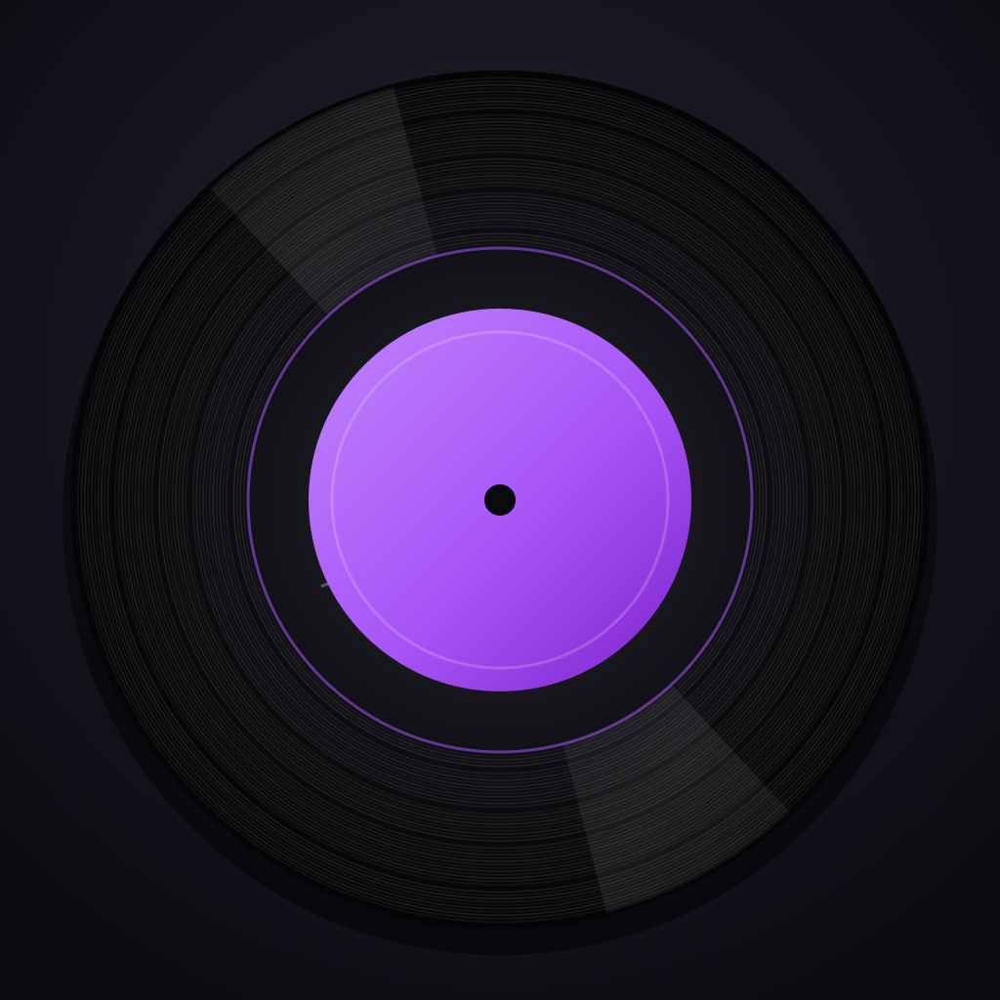
</p>

<p align="center">
  <a href="https://github.com/real-lizardwizard/deadwax/releases"></a>
  <a href="https://github.com/real-lizardwizard/deadwax/pkgs/container/deadwax"></a>
</p>

*Formerly **jimbrainz**. Dead wax is the blank ring between a record's last groove and its label, where the matrix number that tells one pressing from another is scratched — which is the whole idea here.*

An app for finding music on MusicBrainz, pulling it down through slskd, keeping the result tidy afterwards, and playing it - on your phone's home screen or in a desktop browser. Search is centred on specific **Releases** and **Release Groups** rather than artists — because most of the time you want one particular pressing of one album, not somebody's entire discography.

Pick the release you actually want, and deadwax searches Soulseek, ranks what comes back against that release's real tracklist, and shows you why each candidate scored what it did. One tap queues it; when it finishes it gets tagged from the MusicBrainz data and filed into your library. Then the app plays it from Navidrome, shows you what you've actually got — including when you're holding three different pressings of the same record — and lets you correct anything that landed wrong.

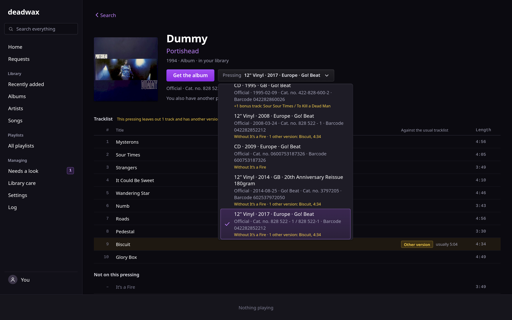

<sub>*Dummy*, opened from Search, on its 2017 vinyl: twenty pressings - vinyl, CD, cassette, SHM-CD, across seven countries - in the Pressing list, each saying only what it changes about the tracklist twelve of them share. This one drops "It's a Fire" and carries a shorter "Biscuit", marked in its tracklist; the CD pressing deadwax already holds is said under Get the album.</sub>

<!--
  These are captured from the running app, at 2x, against stand-ins for Navidrome and slskd
  shaped from their own code, with MusicBrainz's answers as it gave them (notes/screenshots.md
  says how). No screenshot claims a real download happened.

  The library is a throwaway one: real FLAC files tagged and filed by deadwax's own code from
  real MusicBrainz releases, with covers from the Cover Art Archive - but the audio is quiet
  noise of the right length, which is why its bitrate reads low for FLAC.

  A moving demo would still be worth having for the search -> candidates -> download flow.
  ffmpeg, for a README-sized GIF out of a screen recording (2-4MB rather than 21):

      ffmpeg -i recording.mov -vf "fps=12,scale=1200:-1:flags=lanczos,split[a][b];\
      [a]palettegen[p];[b][p]paletteuse" -loop 0 assets/videos/demo.gif
-->

_Please note; this is a silly and fun container i made for my own server, its probably kinda shitty, the code is a mess, and theres certainly better alternatives out there. buuut if you like it thats awesome :)_<3

> **New here?** [The guide](docs/README.md) covers everything, step by step: [getting started](docs/getting-started.md), [every setting](docs/configuration.md), [finding music](docs/finding-music.md), [downloading](docs/downloading.md), [organizing](docs/organizing.md), [the library](docs/library.md), [the app and its player](docs/player.md), [sharing deadwax](docs/sharing.md), [how matching works](docs/matching.md) and [troubleshooting](docs/troubleshooting.md). This README is the tour.

> **Heads up:** this is a fork of [LidBrainz](https://github.com/dual-shock/lidbrainz) that has diverged a long way. LidBrainz sends things to Lidarr; deadwax cut Lidarr out entirely and talks to slskd directly. If you want the Lidarr version, go use the original — it's good.

## Why not Lidarr?

Because of one specific thing that couldn't be fixed from the outside.

When you pick a *particular* release — the 2011 remaster, the deluxe edition — and hand it to Lidarr, all of that detail dies at the API boundary. Lidarr's search command only takes an album id, so the plugin doing the actual Soulseek search rebuilds a generic query from scratch and grabs whatever comes back. Tubifarry's own maintainer [confirms Custom Formats can't target the release variant you selected](https://github.com/TypNull/Tubifarry/discussions/138).

deadwax already knows everything about the release you clicked: its MBID, full tracklist with durations, edition tags, year, label. So it does the searching and the matching itself, and all of that context is actually used.

A caveat worth setting expectations on: this won't magically always find the exact remaster. Soulseek folder names are typed by strangers and frequently omit edition text entirely. What it does is *rank* candidates against your real tracklist and show its reasoning, so you can pick with actual information instead of hoping. Edition matching is a weighted signal, never a hard filter — filtering on it would hide perfectly good results.

## Installation

_The full walk-through, with the three folders explained, is in [Getting started](docs/getting-started.md), and every setting is in [Configuration](docs/configuration.md)._

_Note: this runs on **OpenMediaVault**, with **[Komodo](https://komo.do)** managing Docker, so the compose file below is the way to run it — see [below](#installation-openmediavault--komodo) for the parts worth getting right the first time. It's an ordinary compose stack, so anything else that runs one will do._

### Prerequisites:
1. a running [slskd](https://slskd.org) instance reachable from this container, with an API key
2. an email address to give MusicBrainz as a contact (deadwax builds the rest of its user agent itself)
3. docker
4. [Navidrome](https://www.navidrome.org), reading the same music folder deadwax files into, and an account on it of your own (not an admin one): the app shows and plays your library from Navidrome ([the app's guide](docs/player.md)). Searching, getting albums and following downloads work without it

### Environment:
1. either clone the repo: ```git clone https://github.com/real-lizardwizard/deadwax.git``` <br> or just grab the ```docker-compose.example.yml``` file
2. fill in the ```docker-compose.example.yml``` and rename it to just ```docker-compose.yml``` (here you can change the exposed port and docker network)
3. put your settings in **either** place — whichever you prefer:
   - the ```environment:``` block of your compose file, which keeps everything about the container in one file. This is usually what you want when something like Komodo, Portainer or Dockge manages your stacks.
   - or ```.env.example```, filled in and renamed to just ```.env```, which keeps your slskd API key out of a file you might paste into a forum post.

   Mixing them is fine: a setting in ```environment:``` wins over the same one in ```.env```, so you can keep the key in ```.env``` and the rest in compose. deadwax logs which source each setting came from when it starts, so you can check it picked up what you expected.

   MusicBrainz asks every app to identify itself with a way to contact whoever runs it, and rate limits the ones that don't ([their rules](https://MusicBrainz.org/doc/MusicBrainz_API/Rate_Limiting)). Set `MUSICBRAINZ_EMAIL` to your email address and deadwax does the rest: it sends `deadwax/<version> ( you@example.com )` with the version it's actually running filled in, so there's nothing to keep up to date when you upgrade. It can be set from Server settings too. If you wrote a `MUSICBRAINZ_USERAGENT` by hand before this existed, it keeps working — its contact is lifted out and used — and Server settings says so.

**`SLSKD_URL` has to be reachable from inside this container**, which is not always the address you type into your browser. If slskd is another container on the same docker network, use its service name and internal port — `http://slskd:5030` — rather than your host's IP and published port. It needs the scheme (`http://`) either way; deadwax says so specifically if it's missing. It can't carry a user name or password, a `?` or a `#`, and **changing it from Server settings takes the API key again**, typed in the same save, so the saved key is never sent to an address it wasn't entered for (nor can the one in compose or `.env` be put back while the address is a new one).

**The one that trips everyone up:** `SLSKD_DOWNLOAD_PATH` has to point at the *same files* slskd writes its finished downloads to, as seen from inside this container. If the two containers disagree about that path, organizing quietly finds nothing. It's the most likely first-run problem by a mile.

`LIBRARY_PATH` is where organized music goes, and it's also what deadwax reads to look after your library (Needs a look, Library care, the Edit panel). If you don't set it, everything else still works — those pages just tell you it isn't configured.

### Upgrading from jimbrainz

It's the same app under a new name, and 0.7.0 is the first release under it. Point your compose file or Komodo stack at **`ghcr.io/real-lizardwizard/deadwax`** instead of `…/jimbrainz` — nothing redirects the old image name, and it stops getting updates at 0.6.20. Nothing else needs changing:

- **Your database is found where it is.** A `DB_PATH=/config/jimbrainz.db` line keeps working as it is, and if you never set `DB_PATH`, the old `/config/jimbrainz.db` keeps being used until a `deadwax.db` exists. Don't rename the file by hand to "match" — leave it.
- If you had the page open during the upgrade, reload it.

### Upgrading from 1.x

**Your library now comes from Navidrome.** 1.x browsed `LIBRARY_PATH` itself; in 2.0.0 the Library tab, album and artist pages, Home's shelves and the player show what Navidrome lists, and say *Connect Navidrome* until it's set up ([setting it up](docs/player.md#setting-it-up)). Search's MusicBrainz results, Get, Requests, Needs a look and Library care work without it.

`http://<host>:8080/` now opens the app at `/player/` - the old page there retired in 2.0.0, and bookmarks and home-screen icons for it land in the app. The last version with that page is the git tag `last-main-page`. [Getting started](docs/getting-started.md#coming-from-1x) says what carries over.

### Which image tag?

| tag | what it is |
| --- | --- |
| `:latest` | **the current release**, 2.0.0 onward: the app, slskd direct, no Lidarr, and what the settings above describe. |
| `:2.0.0`, `:1.1.8` etc | pinned releases of that same line (0.6.20 and older are under the old `jimbrainz` image name) |
| `:experimental` | `main`, rebuilt on every push. Ahead of `:latest` until the next release is tagged, and moves under you. |
| `:player` | the 2.0.0 pre-releases, no longer updated: move to `:latest` or `:2.0.0`. |
| `:0.2.1` and older | the original Lidarr-based line (git tag `v0.2.1`). Does **not** understand the settings above. |

> **If you were already pulling `:latest` from before 0.3.0, read this.** Up to 0.2.1 that tag was the Lidarr-based version. From **0.3.0 onward it is this slskd-direct rewrite**, which has no Lidarr support at all and takes different settings. Pulling `:latest` will replace one with the other. Pin **`:0.2.1`** if you want the Lidarr version to keep working.

The example compose file points at `:latest`, which moves only when a release is tagged. Pin a version (`:2.0.0`) to hold still for good, or use `:experimental` to follow development as it happens.

### Running
run docker compose from the same folder as your cloned repo / docker-compose file:<br><br>&nbsp;&nbsp;&nbsp;&nbsp;&nbsp;&nbsp;`docker-compose up -d`<br><br>this by default starts the container on localhost:8080, or whatever port you configured it to.

Organizing starts in **`dry_run`** mode on purpose — it logs what it *would* do and touches nothing. Watch the event log, confirm it's finding your files and building sane paths, then switch `ORGANIZE_MODE` to `copy` or `move`.

## Features (and sorta how they work)

deadwax is one app, at `/player/` (`http://<host>:8080/` opens it too): five tabs - **Home**, **Library**, **Search**, **Requests** and **You** - with a music player inside them, laid out for a phone, and for a desktop in a window 1024 pixels wide or more. Everything below is in it, on both.

### Release centered querying
<details>
<summary style="font-style:italic">Everything is a release group, not an artist</summary>
Most tools use Artist objects as the "main" form of adding and storing data, i didnt like this as 99% of the time i dont want ALL the releases of an artist, i usually just want 1-2 albums. deadwax searches release groups, then lets you drill into the exact pressing you want.
</details>

### Search
<details>
<summary style="font-style:italic">One box, your library first, then MusicBrainz</summary>
One box, one list as Apple Music shows it: <em>Top results</em> - the best artist, album or song, yours or not, each saying what it is - then <em>Artists</em>, <em>Albums</em> and <em>Songs</em>, each with yours first and then MusicBrainz's, chips to narrow it to one kind in full with <em>More</em> for the next pages, and nothing drawn ever moving under your finger as MusicBrainz's answers arrive. "portishead third" is read as Third by Portishead, "third portishead" too, and an artist's name alone asks MusicBrainz for their studio albums and EPs, said in a line under them. A song of yours plays from it through its album; a MusicBrainz song - every take of one song one row - opens onto the albums it's on (albums first, compilations and live albums behind one line), and its <em>Get</em> gets that album on a pressing with the song.
<br><br>
Everything MusicBrainz has answered before is saved on disk and searched too, under any words, its finds drawn first and marked <em>saved</em> - search "portishead", open Dummy, and "glory box" later finds Glory Box at once, even with MusicBrainz away.
<br><br>
An artist's name opens their page, with everything they've released, oldest first - <em>Studio only</em> on to start with - because sorting fifty search results by year gives you the oldest of the fifty most <em>relevant</em>, which for most artists is bootlegs with the actual albums scattered among them. Asking for everything credited to one artist is the only way "oldest first" means what it says.
<br><br>

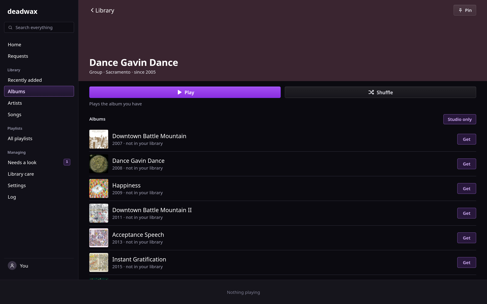

</details>

### The album you don't have, and its pressings
<details>
<summary style="font-style:italic">Before you download a fourth copy of Dummy</summary>
An album you don't have opens laid out like an album you have, on its usual pressing - one with the album's most common tracklist, preferring an official CD or digital release - with a <em>Pressing</em> dropdown: every pressing MusicBrainz knows, each with its status, date, labels, catalogue number and barcode, and a filter for an album of more than 30. Under it, <strong>the tracklist, once</strong> - the one most of its pressings share - and each pressing says only what it changes about it: a bonus track and what it comes after, the song it's missing, a rename, and any track far enough off the usual length to be <em>another version</em> - The Slow Rush has two digital releases whose tracklists are identical apart from "Borderline" running 36 seconds longer, which is a different mix and nothing else would tell you. A second or two of difference is rounding and is ignored.
<br><br>
Every pressing you already have is marked <em>In your library</em>, so the one you don't have yet is the one without. It goes by the MusicBrainz ids in your tags, so it knows the <em>pressing</em>, not just the album: every album deadwax filed or corrected has them. A folder with no ids at all, from a library older than deadwax, can only be matched by artist and album name, so it says <em>maybe in your library</em> - the name can't tell which edition it is. Matching its release in <em>Edit</em> settles it. An album you have has <em>Other pressings</em> on its own page, to get the deluxe beside the standard.
<br><br>


</details>

### Get, and the sources it ranks
<details>
<summary style="font-style:italic">Scored against the pressing you actually picked, with the reasoning shown</summary>
<strong>Get the album</strong> gets the pressing you chose. Each peer's files get grouped into (user, folder) sources (an album shared one folder per disc, <code>CD 1</code> and <code>CD 2</code>, is one source, and each track is paired with a file from its own disc) and scored on track count, fuzzy title match against the real tracklist, track durations, format/bitrate, peer health, and edition/year. Each source is a card with its score, and a tap shows <em>why</em> it scored what it did: the six signals as chips, and the edition words found in the folder's name. Above them are <strong>Lossless</strong>, <strong>24-bit</strong>, <strong>320 kbps</strong> (when that's your quality floor), <strong>Free slot</strong> and <strong>Complete albums only</strong>, and the sort - best match, highest quality or size; on a desktop, a <strong>Signals</strong> filter for the least each part of the score may be, and a sample-rate floor. Each floor is judged by the folder's worst file, and a folder whose user's client didn't say is left out rather than guessed at. <em>Search again</em> edits the query.
<br><br>
The speed on a card says where it comes from. Soulseek reports the peer's average upload rate across their whole history, to everyone, so it reads <em>their own average</em> - not a prediction of your transfer. Once you've actually downloaded from someone, it reads <em>what you got from them</em> instead - what deadwax measured itself while bytes were moving, with queue time excluded, the one number on the card that was measured rather than claimed. peer health is the lowest of the six signals, an availability tiebreaker rather than a ranking criterion.
<br><br>
It searches under every name the artist has put records out under, because Soulseek needs every word of a search somewhere in a share's path - so a search for "Ye BULLY" can never find a share filed under <code>Kanye West/</code>. It tries the name on the release, the name the artist goes by now, and any name MusicBrainz marks as one they've stopped using, all at once rather than one after another.
<br><br>
<strong>Get</strong> won't fetch what you already have. On a pressing that's in your library complete it doesn't search Soulseek at all, and says where the album is, how many tracks and in what format; on one that's already downloading in full it names the user it's coming from and how far it has got. A pressing you have only part of is searched as usual, with a note saying which of its tracks you have and whether a download would fill in that folder or be filed as a separate one. It's checked on disk each time, and it counts the pressing's tracks, not files. You's <em>Pick the best source for me</em> queues the best match itself when one scores 75 or more under your quality floor.
<br><br>

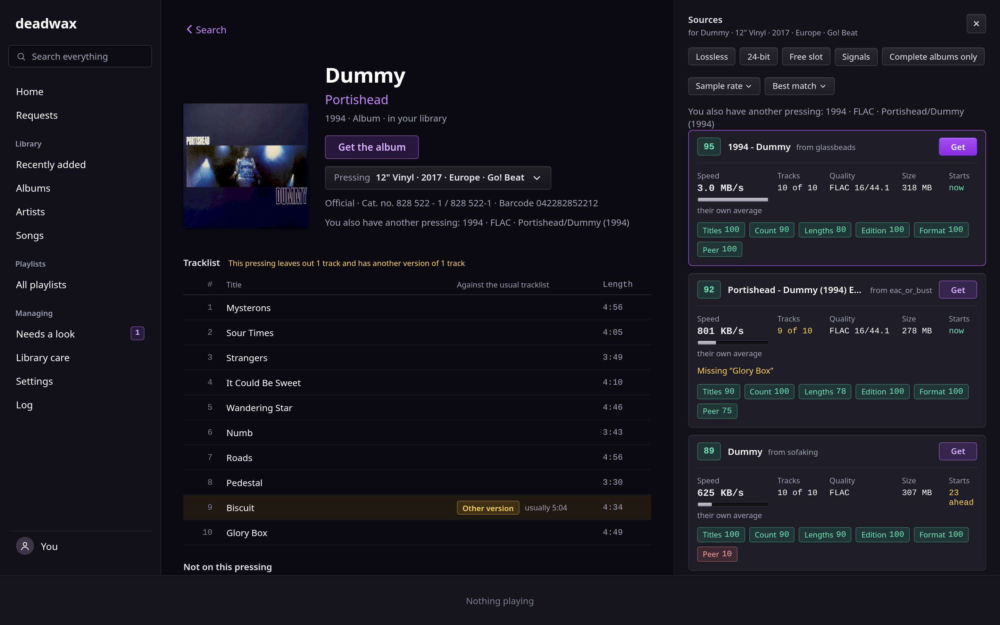

</details>

### Requests
<details>
<summary style="font-style:italic">slskd only knows "bob is sending you 12 files"</summary>
deadwax keeps the link between a download and the MusicBrainz release that started it, in a small sqlite database. That's what makes tagging possible later, and it's why <strong>Requests</strong> can tell you what an in-flight transfer actually is - with live progress, its place in the user's queue, and a real transfer rate worked out from byte deltas rather than slskd's cumulative average, which only ever creeps upward. A download is there the moment you tap Get, reading <em>asking slskd…</em> while slskd connects to the peer, and if slskd can't queue it, the row says why - usually that the peer is offline.
<br><br>
One that fails, or that you cancel, can ask the same peer again with <em>Ask again</em>, for just the files that didn't arrive, or move to the next peer from the list you picked it from, with <em>Next peer</em>, skipping any peer already tried; turn on <code>AUTO_RETRY_PEER</code> and it happens by itself. Cancelling asks first, in the card, never in a pop-up that would hold up the music. A done download opens its album, and plays it from a round play button; Home shows what's arriving.
<br><br>

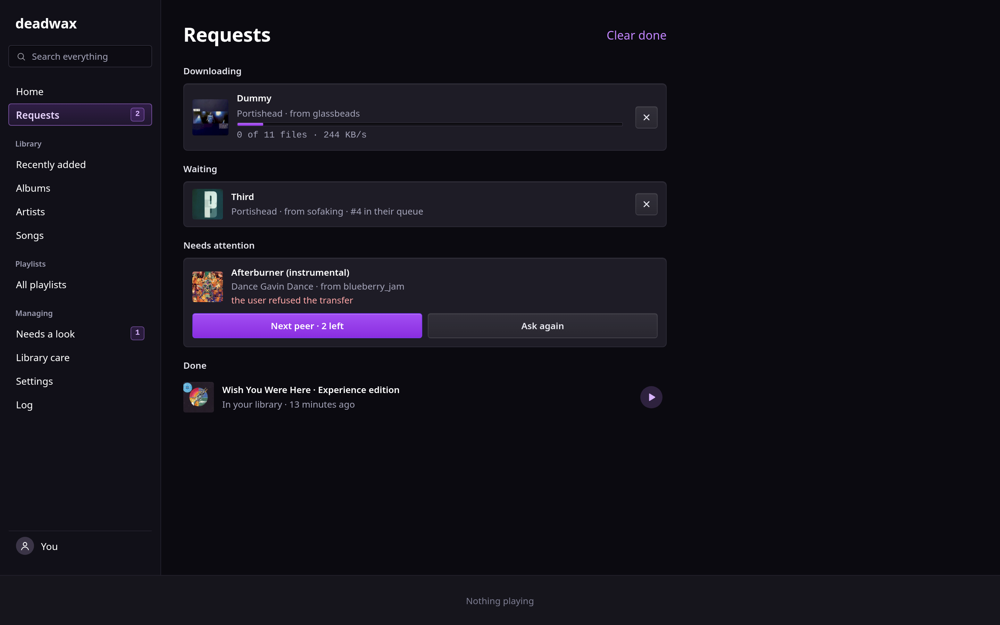

</details>

### Tagging and filing, with editions kept apart
<details>
<summary style="font-style:italic">Two pressings of one album no longer collide</summary>
Files land as <code>{artist}/{album} ({year}) [{edition}]/{NN} - {title}.{ext}</code>, tagged from the MusicBrainz release — including MusicBrainz IDs, so the library stays readable by Picard and beets instead of being a deadwax-only artifact. Track numbers and titles come from the matched tracklist, so they're right even when the peer named everything "Track 04.mp3". It never overwrites an existing file, and it won't file a second copy of an album beside the first: a track the folder already has, in any format, stays in slskd's folder along with that download's sidecars, while a missing one still files, so a second download can finish a partial album. In move mode the slskd folder it came from is cleared away afterwards, leftover junk and all — the art and sidecars worth keeping have already moved into the library by then — unless music is still sitting in it, which means something in there was never filed and the folder stays. Re-filing an album that empties its old artist folder takes that folder with it too.
<br><br>
The edition suffix is omitted for ordinary albums, and only appears when there's something to say. That includes <em>alternate performances</em> — an instrumental or acoustic version has the same track titles and numbers as the album it accompanies, so without a marker it would land in that album's folder, every file would be skipped as already-present, and the import would tell you there was nothing to do. The name comes from MusicBrainz's own disambiguation where it has one, then detected edition tags, then the format when it's something other than a plain CD or download — and two genuinely different releases that would still collide get separated by catalogue number. The release's country isn't used unless you turn on <code>COUNTRY_IN_FOLDER</code> (in Server settings too), since nearly every CD is some country's and <code>Dummy (1994) [GB]</code> says nothing you needed.
<br><br>
The year is the <em>album's</em> year, not the pressing's, so a 2011 remaster of a 1975 record files under <code>Wish You Were Here (1975) [Remastered]</code> rather than landing in a different decade from the original. The file still records which pressing it actually is.
<br><br>
The artist folder is the artist's <em>current</em> name, so one artist is one folder however many names their records came out under. Ye's albums are credited "Kanye West" up to 2024 and "Ye" after; they all file under <code>Ye/</code>, with the <code>albumartist</code> tag to match, so players that group on that tag show one artist too. The credit isn't thrown away — each track's <code>artist</code> tag still says what the sleeve says, and the Soulseek search still asks for "Kanye West", because that's what people named their folders. Albums you already have under an old name move with <em>Move albums to …</em> on the artist's page, or when you pick their release again.
<br><br>
The album folder's name can be changed in Server settings with a template — <code>{year} - {album} [{edition}]</code>, say — from <code>{album}</code>, <code>{artist}</code>, <code>{year}</code>, <code>{release_year}</code>, <code>{edition}</code>, <code>{format}</code>, <code>{country}</code> and <code>{catalog}</code>. A token with nothing to say takes its brackets with it, so one template covers an album with an edition and one without, and the settings row previews it on two real albums. The artist folder above it is always the artist. Albums already filed keep their folders until a release is applied to them.
</details>

### The Library and the album page
<details>
<summary style="font-style:italic">Your library from Navidrome, laid out like Apple Music's</summary>
The <strong>Library</strong> is Navidrome's: at its top <em>Playlists</em> - Navidrome's own, made as you, so Amperfy shows the same ones - then <em>Albums</em>, <em>Artists</em> and <em>Songs</em>, each a page of its own, and the 12 newest albums with <em>See all</em> under them: your albums in a grid in seven orders - by artist (each artist's albums oldest first), by title, recently added, by year either way, recently played or most played - under headers for each letter, year or month, with an A-Z index down the edge to jump or drag through and a <em>Find</em> field that narrows the page as you type; and <em>Shuffle</em> at the top playing your whole library once through.
<br><br>
An album's page has Play and Shuffle, a pin that puts it on Home, its artist a link to their page, an "Also: …" chip for each other pressing you have and <em>Other pressings</em>, and its discs under "Disc 1", "Disc 2" headings, with a disc's own title beside its number where it has one ("Disc 4 · Live at Wembley"). deadwax writes the title (the <code>DISCSUBTITLE</code> tag, which Picard and Navidrome use too) wherever MusicBrainz gives a disc one, and you can set it by hand for the discs it doesn't. Tap its cover to see it full size - zoom, pinch and drag - and at its foot <em>Properties</em> say the album's year against this pressing's ("1994 (this pressing 2014)"), its size, its release on musicbrainz.org and when deadwax first saw it, or filed it.
<br><br>
deadwax reads your library off disk with mutagen too - every folder, ones Navidrome doesn't list included - for looking after it. The last scan is saved in deadwax's database, so after the first time it draws at once, says how old it is, and checks the disk for changes underneath. An album deadwax files from a download turns up on its own once Navidrome has scanned it. If you change files with another program, use <em>Rescan</em> in Library care.
<br><br>

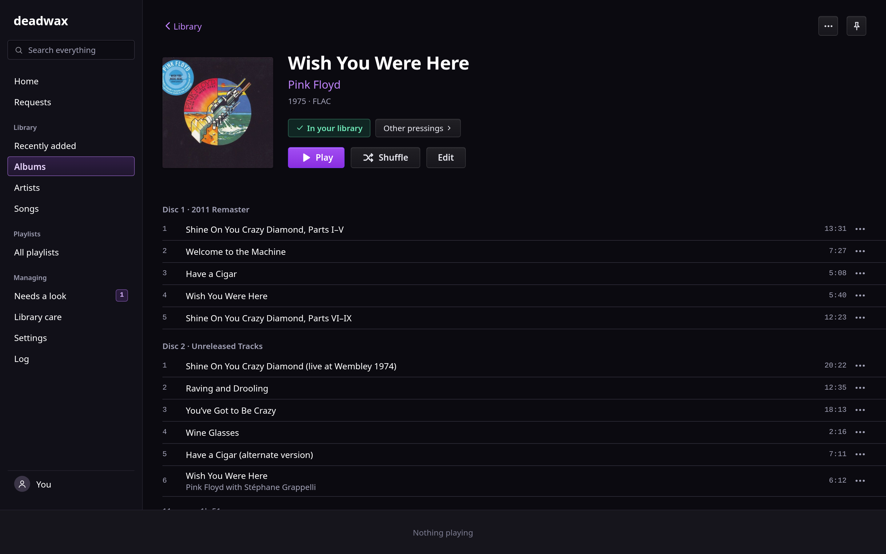

</details>

### Edit: fixing things that landed wrong
<details>
<summary style="font-style:italic">Pick the release an album really is, and write it back</summary>
An album's page has <strong>Edit</strong> (for the admin - everyone, with logins off), which opens the <em>Edit album</em> panel beside the page on a desktop, or a sheet over it on a phone: <em>Release</em>, <em>Tags</em>, <em>Artwork</em>, <em>Lyrics</em> and <em>Delete</em>. <em>Release</em> is Picard-shaped, but small: it searches MusicBrainz straight away; the release your files are already tagged with sorts first and is marked <code>current</code>, so you can see what it currently matches instead of hunting for it. Pick a release and it fills in the fields, or type them yourself — artist, album, year, original year, and the edition name that names the folder. So if MusicBrainz says "remixed by john" and you'd rather the folder just said <code>[REMIX]</code>, type that.
<br><br>
Nothing is written until you press apply, and the preview showing what would change is produced by the same code that does the writing — so it can't drift into lying about it. When an apply changes both the tags and the folder, it writes the tags first and renames afterwards, because Navidrome loses an album's plays, ratings and favourites when both change at once: deadwax asks Navidrome, and renames as soon as Navidrome has scanned the new tags — usually a few seconds. If no scan comes within 90 seconds, or Navidrome can't be reached at all, it leaves the folder where it is and says so, rather than renaming blind. Apply again once Navidrome has caught up. It can also pull the release's cover into the folder, with the incoming art shown next to the one you already have: compare the two <em>at full size</em>, side by side, with their real pixel dimensions and the larger one marked, each zooming and moving on its own.
<br><br>
Multi-disc releases are tagged per disc, the way MusicBrainz and every player number them: disc 2 starts at track 1 of disc 2 rather than carrying on from disc 1. Single-disc albums aren't given a disc number at all, so an album that's already right still reads "nothing to change". An album kept one folder per disc — <code>Album (Disc 1)</code>, <code>Album (Disc 2)</code> — is flagged, and applying the release to each folder puts the discs back together in one, but only once it's certain they're the same release and different discs. Covers are saved at 500 × 500 unless you choose otherwise: <strong>Cover art</strong> in Server settings offers 250, 500, 1200 or <em>full size</em>, which is the original upload.
<br><br>
Tags record <strong>who</strong> as well as what: <code>musicbrainz_albumartistid</code> and <code>musicbrainz_artistid</code> go in alongside the release ids, and a track credited to somebody else — a split, a compilation, a guest spot — keeps its own artist, with credits read the way MusicBrainz writes them: "A / B", "A & B", "A feat. B".
<br><br>


</details>

### Editing tags by hand
<details>
<summary style="font-style:italic">One track, or a whole selection at once</summary>
For everything a release can't fix — a genre MusicBrainz doesn't carry, a composer credit, the one track that ended up on the wrong disc. Tick tracks in <em>Edit → Tags</em> (Shift ticks a run on a desktop), then <strong>Edit N tracks…</strong>; with nothing ticked it edits every track in the album, and a track's own page edits just that one.
<br><br>
It covers title, artist, album, album artist, track and disc number, disc title, year, original year, genre and composer. A field where the tracks disagree says so and starts empty, and <em>left alone it keeps each track's own value</em> — only the fields you actually change are written. Empty a field to remove that tag. The preview lists every change, file by file, before anything is written, and it comes from the same code that does the writing. If any part of an edit is invalid, the whole thing is refused rather than half-applied. It's tags only: no file is renamed.
<br><br>
A track's name opens what's inside it: every field deadwax reads, the pictures embedded in the file, its lyrics and every tag it carries.
</details>

### Needs a look, and Library care
<details>
<summary style="font-style:italic">What's wrong with each album, and the runs that fix a whole library</summary>
<strong>Needs a look</strong> lists the albums whose tags, folder or cover want attention, the ones Navidrome doesn't list (<strong>Not in Navidrome</strong>, checked against Navidrome's albums by release id, or by name for an untagged rip) and the ones deadwax filed that you haven't looked at, with a chip for each kind of issue - and, last, <strong>Ignored</strong>, for the albums whose issues you accepted, so no folder on disk is ever out of reach. Tapping one opens the same Edit panel on it, which then steps through the list (<em>3 of 17</em>, Next) while the rows stay put, each saying Fixed, Ignored or Deleted as you go.
<br><br>
<strong>Library care</strong> has <em>Rescan</em>, and <em>Get covers · N</em>, <em>Get CD art · N</em> and <em>Get lyrics · N</em>: runs over every album missing one, one album at a time, stoppable, narrowed by a few typed words if you like.
</details>

### Artist pages, with pictures

An artist's page has their picture, a <em>Pin</em>, Play and Shuffle over every album of theirs you have, their albums as MusicBrainz lists them - every one, oldest first, with what you have marked and a Get on the rest (a renamed artist's albums under both names together) - and under them what your library holds of them, and who MusicBrainz says they are: their other names, where they're from, how long they've been going, what MusicBrainz tags them as, the line-up with instruments, and their official site and socials named after where they actually go (two of a kind say which is which: <em>Official site · portishead.co.uk</em>, and <em>(archived)</em> for one the Wayback Machine kept).

Their own pictures: **MusicBrainz has none** — the Cover Art Archive is for releases, and what musicbrainz.org shows on an artist page is a Wikimedia Commons photo reached through Wikidata. deadwax uses that too, and adds <strong>fanart.tv</strong> and <strong>TheAudioDB</strong> if you give either a key in Server settings — between them they have the banners, logos, backgrounds and wide shots an artist page is actually made of. fanart.tv's artwork is voted on by the people using it, so deadwax offers the most-liked of each kind first; its key is issued per application rather than per person, so you register your own at fanart.tv. <em>Artist images…</em> shows every candidate each source offered, so you choose which belongs at the top of the page, and they're written into the artist's folder, so <em>other things read them too</em>:

| what | file | who reads it |
| --- | --- | --- |
| square image | `artist.jpg` | **Navidrome, with no configuration at all** — its `ArtistArtPriority` already looks for `artist.*`. Kodi and Jellyfin too |
| banner | `banner.jpg` | Kodi, Jellyfin |
| logo | `logo.png` | Jellyfin; Kodi reads it as clearlogo |
| background | `fanart.jpg` | Kodi's fanart, and one of Jellyfin's backdrop names — one file serves both. The artist page uses it too |
| wide image | `landscape.jpg` | Kodi's landscape, Jellyfin's thumb |
| clear art | `clearart.png` | Kodi |

Finding the right artist copes with them having **renamed**, which is commoner than it sounds. MusicBrainz keeps one current name per artist and every previous one as an alias, while each release keeps the name it was *credited* under — so Ye's albums are credited Kanye West, your folder is called Kanye West, and MusicBrainz's artist is called Ye. deadwax searches aliases as well as current names, and compares them ignoring how a name happened to be typed, so `Motorhead` finds Motörhead and a plain hyphen finds JAŸ‐Z. The page says "Now: Ye" when MusicBrainz calls them something other than your folder does, and <em>Move albums to …</em> moves the old name's albums under the new one. Two artists genuinely sharing a name are refused rather than guessed at — that's what <em>Which artist is this?</em> is for.

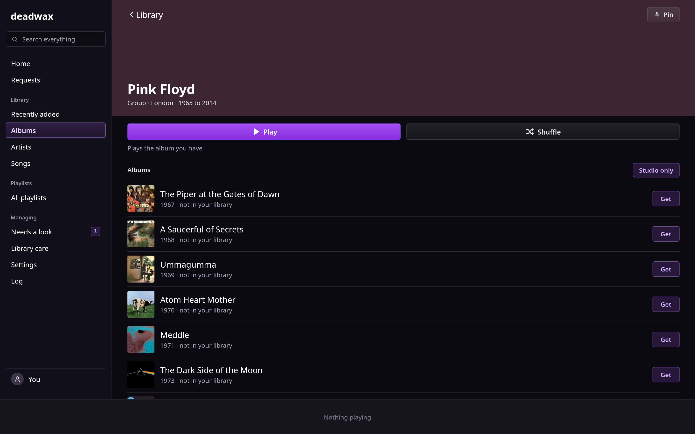

### CD art, and the pictures inside your files
<details>
<summary style="font-style:italic">Why a song can show a different picture from its album, and what to do about it</summary>
Players don't always show a song with its album's cover. Navidrome (and so Amperfy, and every other Subsonic app on top of it) shows a song's <strong>own embedded picture</strong> when its file has one, and otherwise the <strong>disc's</strong> picture when the song has a disc number — which it looks for as a <code>disc*</code> or <code>cd*</code> image beside the tracks. Files off Soulseek often carry a picture somebody else embedded, and downloads often come with a <code>cd.jpg</code> scan, so a song can end up showing another edition's sleeve or a photo of the CD. A track's <strong>Pictures in this file</strong> lists each one with its type (front cover, the disc itself, back cover…), its real size, and a tap to see it full size.
<br><br>
<strong>Get CD art</strong> (<em>Edit → Artwork</em>, or Library care's <em>Get CD art · N</em> for every album missing it) puts a proper picture of the disc in that slot, as <code>disc.jpg</code> beside the tracks — or <code>disc1.jpg</code>, <code>disc2.jpg</code> for each disc of a set, which is how Navidrome matches them to their disc. It comes from the Cover Art Archive's pictures of the disc for the <em>exact release</em> the album is tagged with, then from fanart.tv's disc art if you've given it a key. A <code>disc.*</code> file sits ahead of a download's <code>cd.jpg</code> in every player's order, so the scan stops being what shows without being deleted, and it never replaces CD art that's already there. It's the face of the record on the player's turntable, too.
<br><br>
If you'd rather songs always showed the album's cover in Navidrome, that's two of <em>its</em> settings: <code>ND_ENABLEMEDIAFILECOVERART=false</code> and <code>ND_DISCARTPRIORITY=cover.*, folder.*, front.*, embedded</code>.
</details>

### Lyrics
<details>
<summary style="font-style:italic">Synced where they exist, saved where your player looks</summary>
Lyrics come from <a href="https://lrclib.net">LRCLIB</a> — free, no key, and the one source with <em>time-synced</em> lyrics for a large part of what people actually listen to. Each track's are saved as a <code>.lrc</code> file with the track's own name, right beside it: <code>07 - Roads.flac</code> gets <code>07 - Roads.lrc</code>. Navidrome reads those with no configuration at all (<code>.lrc</code> is in its default <code>LyricsPriority</code>), and Jellyfin and Kodi read them too. The audio files themselves aren't touched.
<br><br>
They're fetched three ways. <strong>As an album is filed</strong> from a download, in the background so it never holds anything up — <code>FETCH_LYRICS=off</code>, or Server settings, turns that off. <strong>Get lyrics</strong> in <em>Edit → Lyrics</em> fetches whatever tracks are still without. And Library care's <strong>Get lyrics · N</strong> runs over every album that has none at all, one album at a time, stoppable, like Get covers. A track's page shows its lyrics, with the time beside each line when they're synced.
<br><br>
<strong>If lines land a beat late</strong> in your player — the line just sung still lit up on a fast song — that's LRCLIB's timings: they're tapped along by people and tend to trail the singing by a fraction of a second. <code>LYRICS_LEAD_MS</code> in Server settings moves every line earlier by that many milliseconds as it's written (300 is a good start), and <strong>Re-time saved lyrics</strong> beside it moves the ones already on disk. It changes the timestamps themselves rather than adding an offset tag, because some players (Amperfy among them) read that tag and ignore it. Re-timing only touches files that are still exactly LRCLIB's lyrics, so it's safe to run again, or after changing the lead.
<br><br>
It's matched on the track's title, artist, album and <em>length</em>, and the length is what keeps it honest: a result more than two seconds out is a different recording — a live take, an edit — and its timings would be wrong. One only a little out gives you its <em>words</em> without its timings. A <code>.lrc</code> already there is never replaced, and an instrumental gets nothing written — an invented "instrumental" line would be a lyric nobody sang.
<br><br>

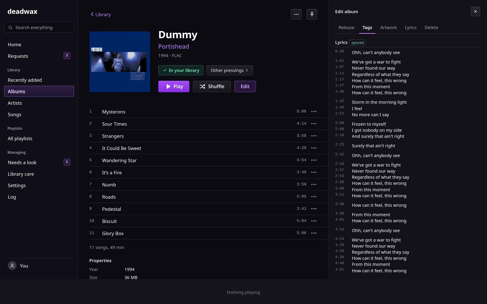

</details>

### Deleting albums
<details>
<summary style="font-style:italic">With a confirmation that actually tells you what's about to go</summary>
<em>Edit → Delete</em>. The confirmation names the folder, the track count, the size, and any files in there that are neither audio nor artwork — a rip log or a cue sheet might be the only copy, so those get listed individually.
<br><br>
It's permanent, there's no undo, and it says so. It refuses anything that isn't an album inside your library, including artist folders, so it can't take a whole discography by accident.
</details>

### Server settings and the log
<details>
<summary style="font-style:italic">A straight answer about the container's configuration</summary>
Split into three pages — Library, Downloads and Connections — and a page says when it holds an unsaved change or a setting that needs attention, so neither can hide behind one you aren't looking at. One save button covers every page. Your own choices - what Get does, the quality floor, Format and whether cancelling asks first - are in You, under Getting albums, kept on deadwax so they follow you between devices.
<br><br>
Most of the container's configuration is <strong>editable</strong>. Changing a setting stores an override in deadwax's own database and applies it <em>without a restart</em> — it does not write to your <code>.env</code>, because editing that from inside the container wouldn't affect the running process anyway. An override wins over the environment (the alternative would mean your edit silently reverting on the next restart), the row says so, and one click reverts it. Two settings can't be changed here and say why: <code>DB_PATH</code> is the database the overrides live in, and <code>PUID</code>/<code>PGID</code> are applied before Python even starts.
<br><br>
For every setting: the value this container <em>actually received</em>, <strong>which file supplied it</strong> (your compose <code>environment:</code> block or <code>.env</code> — indistinguishable from the value alone, and always the first question when something's wrong), and what is broken about it if anything. It resolves the paths rather than trusting them: <code>SLSKD_DOWNLOAD_PATH</code> pointing at a path that exists on the <em>host</em> but not inside the container is the most common first-run failure by a wide margin, and it is invisible from the value. It also answers "why did nothing get filed" once, in a sentence, with every reason listed. API keys and the Navidrome password are never sent to the browser at all.
<br><br>
The <strong>Log</strong> is deadwax's event log - searches, queueing, filing, and anything that went wrong, in slskd's or MusicBrainz's own words - the last 500 lines since deadwax started and then live, as text.
<br><br>

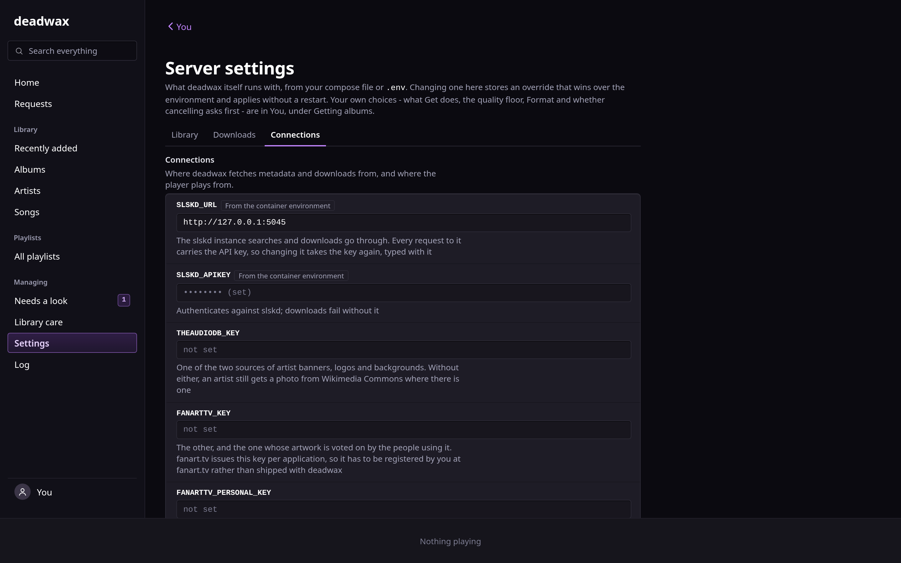

</details>

### The player
<details>
<summary style="font-style:italic">Your library from Navidrome, on your home screen, without the App Store</summary>
Open <code>/player/</code> on your iPhone in Safari, tap Share, then <strong>Add to Home Screen</strong>, and deadwax opens full screen like an app. <strong>Home</strong> has what's arriving, only while something is; the albums and artists you've pinned, with <em>Edit</em> to reorder and unpin them; what was added recently; and what you haven't played in a while. <strong>You</strong> has how Get works for you, the playback settings, whether deadwax can reach MusicBrainz, slskd and Navidrome, and the version - and, for the admin, <em>Managing deadwax</em>: the albums that need a look, Library care, People (Navidrome's accounts, with logins on), the server settings and the log. Each tab keeps its own pages, as an iPhone app's do.
<br><br>
A mini player sits above the tabs, and a full now-playing screen opens from any tab and drags down to close - and close the app and open it again, on the same phone or a computer, and what was playing is back, paused where it stopped, Up Next with it, kept as your play queue in Navidrome. Its <strong>Up next</strong> shows what plays next, with <strong>Shuffle</strong> and <strong>Repeat</strong> (all, or one) at its top, and every song's and every album's <strong>•••</strong> has <em>Play Next</em>, <em>Play Last</em> and <em>Add to a playlist…</em>. It keeps playing in the background, with the song, its cover, previous/next and a scrubber on the lock screen and in Control Center, and an AirPlay button when there's a speaker to send to. A song that won't load is asked for once more and then skipped, with a note saying so, so one bad file or a dropped connection doesn't stop an album playing in your pocket.
<br><br>
It has a second look, a <strong>turntable</strong>: the album's CD art on a record turning at 33⅓, or a black record with the cover as its label, and an arm that moves in towards the middle as the song plays. Turn the record to move through the song, 1.8 seconds a turn as real vinyl, backwards too - and, for a FLAC song, hear it as you turn it, faster, slower and backwards, silent while your finger rests, about an eighth of a second behind your finger; flick it and it keeps turning, coasting to a stop or, if the song was playing, brought back to speed by the motor. Drag the arm to jump anywhere; tap the record to pause, and the sound winds down with the record. Beside the platter a <strong>speed fader</strong>, as a deck's pitch control, plays the song from 0.25x to 2x with its pitch moving with it. At 1x nothing about playback is touched, and the record's sound is a separate stretch of the song deadwax cuts for it, so the song itself plays exactly as it always does. A <strong>test bench</strong> at <code>/player/lab/</code> turns the real turntable over test tones, or a song from your library, beside a perfect turntable turned the same way (<a href="docs/player.md#testing-the-turntable">the guide</a>).
<br><br>
<strong>Normalization</strong> brings every FLAC song to one loudness by deadwax itself (measured as ReplayGain 2.0 measures it, to -18 LUFS, never clipped, in 24-bit copies; nothing written to your files): an album you play kept at one level for the whole album, anything else levelled song by song, by default - or by song, by album, or <em>Off</em>, which is bit for bit what deadwax sends otherwise. Safari doesn't come in where it's asked in a FLAC whose loudness changes through the song, but it lands exactly in an MP4 holding the same FLAC audio, so Safari, and every browser on an iPhone, gets its FLAC songs repackaged that way: bit for bit the same audio, nothing transcoded, the library untouched. It's kept, up to 1 GB (<code>PLAYER_CACHE_MB</code>), in the container's temporary space, or on a fast disk of your choosing with <code>PLAYER_CACHE_PATH</code>. <a href="docs/player.md#seeking-and-where-safari-lands">The guide</a> has the measurements.
<br><br>
<strong>Gapless:</strong> with <strong>Gapless</strong> ticked in You, FLAC songs played one after another are joined into <strong>one stream</strong> on a single audio player, each song starting on the exact sample where the one before ends, so there's nothing to hear between them, locked or not. A 24/192 album joins the stream too: <strong>Maximum quality</strong> is set by default to <strong>Up to 48 kHz</strong>, which has deadwax resample FLAC songs above 48 kHz to 48 kHz (or 44.1 kHz), still lossless 24-bit FLAC - an iPhone plays at most 48 kHz anyway. <a href="docs/player.md#gapless-playback">The guide</a> has the rest.
<br><br>
It plays from <strong>Navidrome</strong>, and its library is Navidrome's, so deadwax needs one: set <code>NAVIDROME_URL</code>, <code>NAVIDROME_USER</code> and <code>NAVIDROME_PASSWORD</code> in Server settings (Connections), or in compose or <code>.env</code> - or from the app itself, a phone included: its <em>Set up Navidrome</em> opens Server settings at Connections. Use an account of your own; it doesn't need to be an admin. The login stays in deadwax, which passes the player's requests on, so the phone never sees your Navidrome password and only ever needs to reach deadwax. It's a short, fixed list of requests rather than a pass-through, so reaching deadwax never means reaching the rest of Navidrome. Plays are reported to Navidrome the way any Subsonic app reports them, so play counts and Last.fm or ListenBrainz scrobbling carry on working.
<br><br>
<strong>What it can't do</strong>, because it's a web page and not an App Store app: no CarPlay, no offline downloads, and no Siri. Playing with the phone locked, and moving to the next song there, have been seen working on a real iPhone. To use it away from home, reach deadwax over a VPN such as WireGuard or Tailscale rather than an open port. Everything else is in <a href="docs/player.md">the app's guide</a>.
<br><br>

<p>
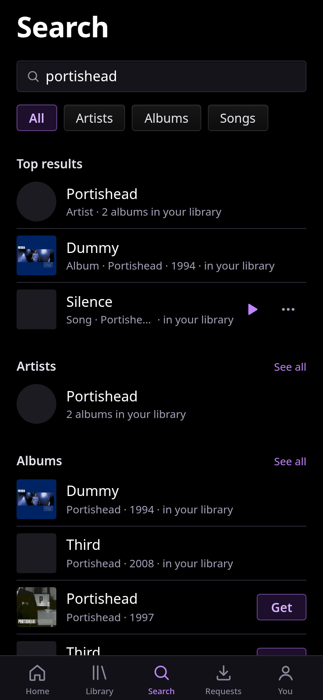
&nbsp;&nbsp;
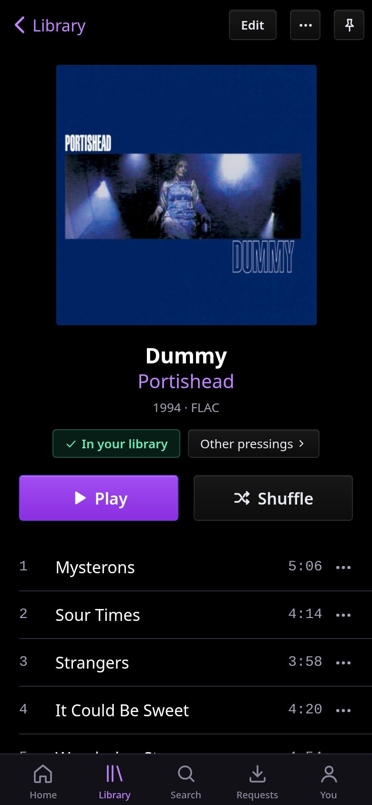
</p>

</details>

### On a desktop
<details>
<summary style="font-style:italic">The same app, in a wide window</summary>
In a window 1024 pixels wide or more the app is laid out for a desktop: a sidebar instead of the tabs - Home, Requests with its count, the Library's views, <strong>Playlists</strong>, and under <strong>Managing</strong> Needs a look (with its count), Library care, People (with logins on), Settings and Log - and the search field, the albums in a grid six across, and a player bar along the bottom with the song, the transport - Shuffle and Repeat beside it - the scrubber, Up Next, Add to a playlist and Info. Info, Up Next, an album's sources and the Edit panel open in a panel beside the page - a third column from 1280 pixels, over the page's edge below that - so on an album you don't have, <strong>Get the album</strong> sits beside the Pressing button, the tracklist gains an "Against the usual tracklist" column, and choosing another pressing searches Soulseek again for it. Resizing across 1024 swaps the layout without stopping the music. There's no turntable on a desktop: instead the player bar opens a full-screen <strong>visualizer</strong> - Bars, Scope, Halo and Ambient, whose styles (a kaleidoscope Mandala, Waves flying towards you, Liquid ink, and five after Windows Media Player's) can rotate in a fixed order - coloured from the cover or in purple. It watches a silent copy of the playing FLAC's stretch that deadwax cuts for it, never the song you hear, so playback is untouched. <a href="docs/player.md#on-a-desktop">The guide</a> has the rest.
</details>

## (more importantly) Non-features (and how they dont work)

Being lightweight and fast (and working _just enough_) was and is the only focus, so recommendations and batch adding artist discographies are not present, and logins are off unless you turn them on.

### Adding whole artist discographies at a time
<details>
<summary style="font-style:italic">deadwax only uses release groups, not artists</summary>
Theres no native feature to add entire discographies quickly (unless you type really fast). There are much better alternatives for that out there.
</details>

### Metadata from anywhere but MusicBrainz
<details>
<summary style="font-style:italic">Tags come from MusicBrainz, and only from MusicBrainz</summary>
Everything deadwax writes into a file's tags comes from MusicBrainz, so if a release isn't there it can't tag it — you can still edit tags by hand. The pictures and lyrics are the exceptions, and they go in files beside the music rather than in the tags: covers from the Cover Art Archive, artist images from Wikimedia Commons (plus fanart.tv and TheAudioDB if you give them a key), and lyrics from LRCLIB.
</details>

### Recommendations
<details>
<summary style="font-style:italic">deadwax can only be used for searching stuff and downloading it</summary>
Theres no tracking of what you download or listen to, so theres nothing to base cool recommendations on.
</details>

### Logins, unless you turn them on
<details>
<summary style="font-style:italic">Off by default: anyone who can reach it can use it</summary>
Out of the box there is no login: anyone who can reach deadwax can use it, as its one admin. It can delete files and rewrite tags, so keep it on your own network or behind whatever you already use for the rest of your homelab, and don't expose it to the internet. To share it, turn logins on (<code>AUTH_MODE=on</code>, with <code>DEADWAX_SECRET_KEY</code> in <code>.env</code>): everyone then signs in with their own <strong>Navidrome</strong> account and has their own requests, their own library (their starred albums in Navidrome, so Amperfy shows the same), their own plays and playlists, while the store on disk stays one. Navidrome's admins are deadwax's admins: only they - and anyone an admin gives a permission to - edit the library, see the review queue and the log, or change the settings, and an admin can make, reset and remove Navidrome accounts from deadwax's <em>People</em>, make someone an admin, and tick what an ordinary person may do (Edit albums, Look after the library, Everyone's downloads, Settings and the log - or take Get albums away for a listen-only account). Plain http is fine on your own network and over WireGuard; put HTTPS in front of it before anything else. <a href="docs/sharing.md">Sharing deadwax</a> walks through it, and <a href="docs/configuration.md#logins-environment-only">the settings</a> are in configuration. With logins on or off, it refuses changes that another website sends through your browser: a page you happen to have open can't make it delete an album. Nor can a saved key or password be sent somewhere new: changing slskd's or Navidrome's address takes that service's key or password again, in the same save, and the one in compose or <code>.env</code> can't be put back while the address is a new one. With logins on, only an admin can change either address, its key or password, or <code>NAVIDROME_USER</code>. Behind a reverse proxy that rewrites the <code>Host</code> header, set <code>TRUSTED_ORIGINS</code> (see <a href="docs/configuration.md">configuration</a>).
</details>

### Undo
<details>
<summary style="font-style:italic">Nothing here can be taken back</summary>
Retagging and editing tags rewrite them in place, and deleting removes files for good. The previews before a retag or a tag edit and the confirmation before a delete are the whole safety net, which is why all of them try hard to tell you exactly what's about to happen.
</details>

## Installation (OpenMediaVault + Komodo)

This is how deadwax actually runs: OpenMediaVault for the box, Komodo managing Docker.

Komodo deploys compose stacks, so there's nothing deadwax-specific to learn — point a stack at this repo, or paste `docker-compose.example.yml` into one, and put the settings in the stack's environment (or in a `.env` beside it; which wins is described above).

Five things are worth getting right the first time:

1. **`PUID`/`PGID` should match whoever owns the media on your OMV share**, and should be the same pair slskd runs as. If the two disagree, deadwax files albums away as a user slskd can't write — or the other way round. OMV's shared folders commonly sit in the `users` group.
2. **`SLSKD_URL` has to be reachable from inside this container.** If slskd is another stack on the same host, put both on one docker network and use its service name and internal port (`http://slskd:5030`) rather than the host address you type into your browser.
3. **`SLSKD_DOWNLOAD_PATH` and the `/downloads` mount have to point at the same files slskd writes**, as this container sees them. It's the most likely first-run problem by a mile, and it fails quietly: organizing simply finds nothing.
4. **Mount your library** where `LIBRARY_PATH` points, or deadwax has nothing to read.
5. **`NAVIDROME_URL` has to be reachable from inside this container** too: the app's library is Navidrome's, so point Navidrome at the same music `LIBRARY_PATH` mounts. With Navidrome on the same docker network, that's `http://navidrome:4533` (plus its base path, if it has one). Give it a Navidrome account of your own that isn't an admin, and keep its password in `.env` or Server settings, like the slskd key. You can also mount a folder on an SSD as `/cache` and point two settings at it: `PLAYER_CACHE_PATH`, for the songs it repackages for Safari and for Gapless (worth it if you'll listen in Safari or on an iPhone), and `MUSICBRAINZ_CACHE_PATH`, for MusicBrainz's saved answers (otherwise kept beside the database in `/config`). Both are only caches, so leave that folder out of your backups.

Leave `ORGANIZE_MODE` on `dry_run` until the event log shows it finding your files, then switch it to `copy` or `move`.

The image has a healthcheck, so Komodo shows whether deadwax is actually working rather than just running. It only judges deadwax itself: slskd being logged out or MusicBrainz being down shows up in the app's You → Connections, not as an unhealthy container, because restarting deadwax wouldn't fix either.

## who is this for?

Most of the music i listen to is on MusicBrainz, so this app uses MusicBrainz to find things and slskd to fetch them.

i didnt like using the MusicBrainz website as a search engine and then switching tabs to kick off a download, so i put it all into one ui. and i got tired of asking for a specific remaster and getting whatever turned up. if you feel the same, this could be for you.

## who is this NOT for
basically anyone who wants more functionality than whats mentioned above. if you want a full library manager with its own metadata pipeline, use Lidarr — genuinely.

## probable issues
- **Organizing finds nothing:** almost always `SLSKD_DOWNLOAD_PATH` not pointing at the same files slskd writes. deadwax says so explicitly when this happens rather than pretending it worked.
- **A download says it finished but the album isnt there:** if a folder with that name already existed, every file is skipped rather than overwritten, and the job now says so instead of reporting success. Usually means you already have that edition.
- **Rate limiting:** MusicBrainz rate limits requests that don't carry a contact, so check `MUSICBRAINZ_EMAIL` is set — Server settings shows the exact user agent being sent. deadwax also has a built-in rate limiter, so if you're getting rate limited more than you'd expect it's likely the contact.
- **A search fails and says slskd isn't connected to Soulseek:** slskd's web API answers whether or not slskd has logged in to the Soulseek network, so deadwax can reach it perfectly while no search can possibly run. You → Connections reports that connection rather than just the API, and a failed search names which of the two is wrong — including when slskd is waiting on a VPN container to come up, which is the usual cause when slskd runs behind one. It answers `409 Conflict` in that state, which is not what the word suggests.
- **A search returns nothing:** Soulseek search is a substring match over filenames people happened to type. Edit the query shown under "Soulseek found nothing for …" and press <em>Re-search</em> — trimming it down often helps more than adding detail.
- **MusicBrainz is just down sometimes:** it happens a lot. deadwax tells you thats what happened rather than showing you an empty result and letting you blame your search terms. Anything asked before still answers, though: deadwax saves every answer MusicBrainz gives it on disk - `musicbrainz-cache.db`, beside its database unless `MUSICBRAINZ_CACHE_PATH` names another folder, 200 MB at most (`MUSICBRAINZ_CACHE_MB`; [configuration](docs/configuration.md#musicbrainzs-saved-answers-settings--connections)) - so a search, an artist or an album asked again is instant, after a restart too - and Search looks through all of it under any words, before MusicBrainz is asked. Searches are refreshed after a week and the rest after a month, quietly, behind the saved answer; deleting the file only costs speed, and Server settings has a Clear for it.
- **slskd's incomplete folder fills with empty folders:** that's slskd - it writes each download under a folder per level of the sharer's path, and when the download finishes it only removes the last of them. Set `SLSKD_INCOMPLETE_PATH` to that folder and deadwax clears the empty ones every ten minutes. It only ever removes empty folders; a half-finished download, which slskd can resume, is left alone.
- **Needs a look or Library care says the library is empty:** check `LIBRARY_PATH` is set and points at the same music the container can see. It says which of those is wrong.
- **The app can't reach Navidrome:** Home and the Library tab say why, in place of your albums (You's Connections says it too); [troubleshooting](docs/troubleshooting.md#the-player-says-connect-navidrome-or-cant-reach-navidrome) goes through each message, and through songs that won't start.
- **An album says "Not in Navidrome":** Navidrome doesn't list that folder, so the app can't show or play it - usually Navidrome hasn't scanned it yet, can't read its files, or it's outside Navidrome's music folder. [Troubleshooting](docs/troubleshooting.md#an-album-says-not-in-navidrome) goes through each.
- **Plays from the app don't show up in Navidrome:** nothing on the phone says so - a play that can't be reported never interrupts the music. [Troubleshooting](docs/troubleshooting.md#plays-dont-show-up-in-navidrome) covers what counts as a play, and the usual reasons they go missing.
- the ui has many problems, i just wanted it to look pretty cause i like pretty things
