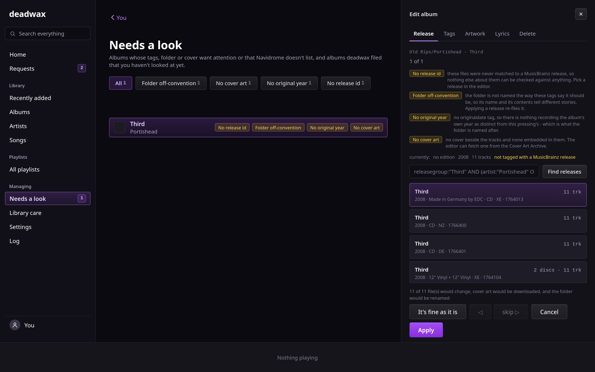
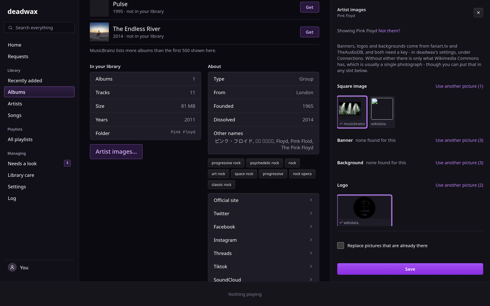

# The library

The **Library** tab shows what's in your music folder (`LIBRARY_PATH`): every album, including
ones deadwax never downloaded. It flags what's wrong with them and lets you fix it.

This page is about the main page's Library tab, the one for looking after the library. The phone
app at `/player/` has a Library tab of its own, for listening - **Albums**, **Artists** and
**Songs** from Navidrome (since 2.0.0-player.46 deadwax needs Navidrome for the app's library, and an
album folder Navidrome doesn't list is raised as [Not in Navidrome](#not-in-navidrome)), and an [artist page](player.md#artist-pages) with their albums from
MusicBrainz and Play and Shuffle over the ones you have - which the [phone player
guide](player.md#what-it-does) covers. [The app on a desktop](#the-app-on-a-desktop), below, says
how that Library is laid out in a window 1024 pixels wide or more, and [Editing an album in the
app](#editing-an-album-in-the-app) how this page's editors work from an album's page there.

## Opening it

The first time, the tab reads the tags off every file, which takes a while for a big library.
The result is saved, so every visit after that draws the saved copy **at once**, marked with its
age, and checks the folders for changes underneath it. Only folders that changed are read
again.

Albums filed from a download appear by themselves. **Rescan** re-reads everything, and is what
to press after changing files with another program: a tag edited elsewhere doesn't change a
folder's date, so it isn't noticed otherwise. In the app it's on **Library care**
([below](#library-care-in-the-app)), on a phone as on a desktop.

The status bar at the bottom counts albums, artists, tracks and size, and says when the library
was last scanned.

## The tree

Laid out like a file explorer: **artists**, their **albums** underneath, and the **tracks**
under an album. An album you hold more than one pressing of says **N editions** on its row, and
opens to one row per edition first.

- **Click** a row to select it and open it. The **triangle** opens and closes without
  selecting.
- **Keyboard**: up and down move, right opens (or steps in), left closes (or steps out), Enter
  toggles, Home and End jump to the ends.
- Rows carry small chips: **New** for albums filed since you last looked, the first
  **issue** that needs attention, and the edition count.
- On a phone, tapping an album or a track opens its details as a sheet; tapping an artist opens
  it in place, and **tapping it again** opens the artist's page.

It stays quick on a big library: only the rows in view are ever drawn.

### Arranging

**Arrange by**: **Artist** (the tree above), **Album**, **Release date** or **Date added**.
The last three list albums directly under headings (a letter, a year, a month). **A–Z** flips
the direction. "Date added" is when deadwax first saw the album, or its folder's date if that's
earlier, so a library that was there before deadwax still sorts sensibly.

### Searching

The search box matches artists, albums, editions, and **song titles** (from two letters). A song
match opens its album and shows just the matching songs. Every artist with a match opens by
itself.

### Views

The views list narrows the tree (behind **Show** on a phone):

- **All albums**;
- **Multiple editions**: albums you hold more than one pressing of;
- **Newly added**: filed from downloads since you last looked at them;
- **Needs attention**: anything with an outstanding issue (below), and one view per issue.

## The details pane

Whatever you select shows on the right (a sheet on a phone):

- **Nothing selected**: the library's totals, and the most recently added albums.
- **An album with several editions**: a table of the editions, each with its year, tracks,
  length, size, format and anything it needs.
- **An album**: the cover (click it for the [cover viewer](#the-cover-viewer)), its facts, a pill
  for each edition, the **tracks**, and **Properties**: every tag that matters, where the cover
  came from, whether tracks carry their own pictures, CD art, and lyrics.
- **A track**: every tag in the file, the pictures embedded in it, and its lyrics.

The command bar across the top holds the album's actions: **Edit metadata…**, **Edit all
tracks…** (or **Edit N tracks…** with some ticked), **Get cover**, **Get lyrics**, **Get CD
art**, **Find on MusicBrainz** and **Delete…**. On a desktop, **Fields ▾** chooses the track
table's columns.

### The track table

Choose its columns from **Fields ▾** (or by right-clicking the header): tags, audio details,
MusicBrainz ids, file details. Drag a header to move a column, drag its right edge to resize
it, and double-click the edge to reset it. On a phone the table is always number, title and
length.

A tag that's only in the file (not the saved scan) shows `·` until the files have been read. A
disc number shown faded is a default: the file has no disc tag, so it counts as disc 1.

A multi-disc set is split under **Disc 1**, **Disc 2** headings, here and in the tree. A disc
that has its own title says it too: **Disc 4 · Live at Wembley 1974**, and so does a set kept
one folder per disc, on each folder's row. The title is the
`DISCSUBTITLE` tag (Picard's name for it; Navidrome shows it as well). deadwax writes it when a
download or an applied release gives the disc a title, and you can set it by hand (below). The
**Disc title** column shows what each file carries, including one that disagrees with the rest
of its disc.

## What needs attention

Each album is checked for these, fresh on every scan:

| issue | means | the fix |
| --- | --- | --- |
| No release id | never matched to a MusicBrainz release, so nothing else can be checked | pick its release in the metadata editor |
| No artist tag | no file names an artist, so the name shown came from the folder | apply a release |
| Mixed tags | the files disagree about which album they're from, often two albums sharing a folder | sort the files out, or apply a release |
| Split across folders | this folder holds only some discs of a release whose other discs are elsewhere | apply the release to each; the second merges into the first, which keeps anything you'd said was fine about it |
| Artist under two names | the artist's albums are under two folder names, usually a rename | **Move albums to …** on the artist's page |
| Folder off-convention | the folder isn't named the way its tags say it should be | apply its release, which re-files it |
| No original year | no `originaldate` tag, which the folder name uses | apply a release |
| No year | no date on any file | apply a release |
| Untitled tracks | some files have no title tag, so filenames are shown | apply a release |
| Unnumbered tracks | some files have no track number, so the order is alphabetical | apply a release |
| No cover art | no cover beside the tracks or inside them | **Get cover** |
| Not in Navidrome | Navidrome doesn't list the album, so the app can't show or play it (since 2.0.0-player.46; [below](#not-in-navidrome)) | let Navidrome scan it, make its files readable to Navidrome, or point Navidrome at this music folder |

**Review N**, in the toolbar, walks through every album that needs attention (and every album
newly filed), one at a time, in the metadata editor. For an album that's right as it is (a
bootleg that will never be on MusicBrainz, say), **It's fine as it is** stops it being flagged
for the issues it has now. It's still flagged if something new goes wrong, such as the cover
going missing.

The app has the same queue, as **Needs a look** ([below](#needs-a-look-in-the-app)) - on a phone too since
2.0.0-player.47.

### Not in Navidrome

The app's library is Navidrome's, so since 2.0.0-player.46 deadwax checks each album folder against
the albums Navidrome lists, and raises one it doesn't as **Not in Navidrome** - here and in the app's
**Needs a look** alike. That way no folder on disk is out of reach: the app can't show or play it, but
the queue lists it and its editors open on it like any other.

- **How it's checked.** A folder is in Navidrome when Navidrome has an album with its release id. A
  folder with no release id (or whose album Navidrome knows by none) is matched by its album title and
  artist instead, as both are spelled in the tags (case, accents and curly quotes aside) - a folder
  whose files name no artist at all as Navidrome's "[Unknown Artist]". A folder with no album artist
  tagged (or Various Artists) also matches an album Navidrome credits to Various Artists by its title
  alone; one with an album artist of its own never does, so Queen's *Greatest Hits* isn't taken for a
  compilation of that name. A folder whose files carry no album tag at all isn't checked: Navidrome
  files those under "[Unknown Album]", with no name to match.
- **When.** Each read of the library is checked against Navidrome's last answer, and never waits for
  Navidrome: when that answer is more than ten seconds old, a read from the disk asks Navidrome again
  behind it, for the next read. Only Navidrome's very first answer (after deadwax starts, or its
  Navidrome settings change) is waited for, at most three seconds, and **Rescan** always asks and waits
  as long, so Rescan is the way to see the check afresh. The saved scan drawn first asks nothing. Usually it's one quick question: Navidrome's
  albums are listed again only once it has finished a scan since the last time.
- **Never too soon.** A folder that changed after Navidrome's last scan began - filed a moment ago,
  filed while Navidrome was scanning, moved or copied in by hand (deadwax goes by when it arrived, not
  the old date `mv` or `rsync -a` keep on it), a release just applied, a cover just fetched - isn't
  newly flagged until a scan that began after it has finished (usually seconds later: Navidrome's file
  watcher scans a change about five seconds after it), and one already flagged stays flagged until
  then, also when deadwax renames or re-files it, and across a restart of deadwax. But not for ever:
  a folder outside Navidrome's music folder never wakes its watcher, so when no scan has come 15
  minutes after the change, the folder is checked anyway. While Navidrome is scanning, only the albums
  already found missing are marked.
- **Nothing raised without an answer.** Until Navidrome has answered, with Navidrome not set up, or
  when it can't be asked, no album is marked, and the app's **Needs a look** says why once, in the line
  above its list where *Checking the library…* shows (see [Needs a look in the app](#needs-a-look-in-the-app)).
  The main page's queue doesn't say.
- **Fixing it** - see [troubleshooting](troubleshooting.md#an-album-says-not-in-navidrome): start a scan in
  Navidrome, make the files readable by the user Navidrome runs as, or point Navidrome at the folder
  `LIBRARY_PATH` reads. **It's fine as it is** accepts it, as for any issue.

## The metadata editor

**Edit metadata…** opens the editor on an album, already searching MusicBrainz using its artist
and album tags. You:

1. **Pick the release** the album really is from the list of pressings. The one the files
   already claim is marked **Current**. Each row shows year, format, country, catalogue number
   and track count; a track count in yellow doesn't match the files.
2. **Check the fields**: artist, album, year, original year, and edition. Blank fields are left
   alone rather than cleared. The edition is worked out from the release unless you type one.
3. **Read the preview**. It shows every tag that would change, file by file; whether the folder
   would move or be renamed (to follow the template, or the artist's current name); and, when
   the album is split across folders, whether it would merge.
4. **Cover art**: tick **download cover art** to save the release's cover from the Cover Art
   Archive, and compare it with the one you have (**Compare full size**) before replacing it.
5. **Apply** writes the tags, fetches the cover and moves the folder. There's no undo, which is
   why the preview shows everything first. When the apply changes both the album's tags and its
   folder, it writes the tags, pauses, then renames. That pause lets Navidrome see the new tags
   first and keep the album's plays, ratings and favourites, which it loses when both change at
   once. With Navidrome set up (the [phone player's](player.md) settings), deadwax asks it, and
   renames as soon as Navidrome has finished a scan that began after the tags were written,
   usually a few seconds; the button reads *Applying, waiting for Navidrome*. Without, it's a
   fixed pause (20 seconds by default, `RETAG_RENAME_WAIT`), and the button names it
   (*Applying, renaming in 20s*). The preview says which, up front. If Navidrome finishes no
   scan within 90 seconds, or can't be reached at all, the folder is left where it is and the
   editor says so. Apply the same release again once Navidrome has scanned: deadwax checks with
   Navidrome first and renames straight away if it has, or waits for a scan again if it hasn't.
   deadwax forgets a held-back rename when it restarts, and after that the next apply renames
   without asking
   ([troubleshooting](troubleshooting.md#applying-a-release-left-the-folder-where-it-was)).
   If a folder of the new name appears during the pause (another copy of the same release
   applied just before), the rename is refused and the album stays where it is, with its new
   tags.

   Navidrome can only say that a scan finished, not which folders it read. With one library
   that's enough, because a scan after a change is the one the change caused, or covers
   everything. With a second library in Navidrome, or an admin scanning some other folder at
   that moment, the rename can come before this album has been scanned.

## Editing tags by hand

Tick tracks in the track table (Shift-click for a range, Ctrl/Cmd-click for one at a time), then
**Edit N tracks…**, or **Edit all tracks…** with none ticked. You can edit title, artist, album,
album artist, track, disc, disc title, date, original date, genre and composer. A disc title is
the one to set for a box set or a bootleg whose discs MusicBrainz leaves untitled: tick that
disc's tracks and type it once.

- A field whose value differs between the ticked tracks starts empty and says **Several
  values**. Leave it alone and each track keeps its own.
- Only fields you change are written. Emptying a field you changed **removes** that tag.
- The preview shows each change before **Apply**. If anything is invalid (a track number that
  isn't a number), nothing is written at all.
- It edits tags only; no file or folder is renamed.

## Covers, CD art and lyrics

- **Get cover** fetches the cover of the release the album's tags name, from the Cover Art
  Archive, at `COVER_ART_SIZE`, and saves it as `cover.jpg` (or `.png`). It only appears on albums
  that have a release id and no cover, and it never replaces one. To replace a cover, use the
  metadata editor, where you can compare the two. **Get covers · N** in the toolbar does every
  album in view that's missing one, one at a time; press it again to stop. "No cover on the
  Archive" and "the request failed" are counted separately, because only the second is worth
  trying again: an Archive that couldn't be reached, or answered with an error, counts as failed
  (since 2.0.0-player.42 - before, it was counted as having no cover).
- **Get CD art** saves a picture of the disc itself, as `disc.jpg` (or `disc1.jpg`,
  `disc2.jpg`… per disc of a set), from the Cover Art Archive's scans of that exact release, and
  otherwise from fanart.tv if you've set a key. Navidrome shows it for the songs on that disc,
  and it's the face of the record on the phone player's [turntable](player.md#the-turntable).
  **Get CD art · N** does every album in view.
- **Get lyrics** looks up lyrics on LRCLIB for the tracks that have none, and saves each as a
  `.lrc` beside its track. The button then reports how many it found (**Lyrics · 9 of 10**, with
  the details in its tooltip). **Get lyrics · N** does every album in view that has no lyrics at
  all.

The three **· N** runs are also the app's, on a phone and a desktop: **Library care**
([below](#library-care-in-the-app)) runs them over the same albums by the same rules.

**Why a song can show a different picture from its album:** some players (Navidrome, and so
apps like Amperfy) show a picture *embedded in the file* over the album's cover, and a disc scan
(`cd.jpg`) for songs with a disc number. An album's **Properties** and a track's view list the
pictures inside the files, so you can see which it is.

### The cover viewer

Click an album's cover to see it full size. Click (or tap) to zoom in on the point you touched,
use the wheel to zoom, or pinch on a phone; drag to move around; click again to fit. In the
metadata editor it shows your cover and the release's side by side.

The app at `/player/` has the same viewer since 2.0.0-player.44: tap an album page's cover, on a
phone or a desktop, to see it as Navidrome has it, unresized; and in the **Edit album** panel,
**Artwork**'s cover and CD art and the pictures inside a track ([below](#inside-a-track-in-the-app))
open in it. Escape, **Close**, the ✕ or a click on the dimmed page round it closes it - and so does
going back (the browser's Back, a mouse's back button, a phone's back gesture), which goes back too.

## Artist pages

Select an artist (on a phone, tap it twice) for their page: a photograph, the facts MusicBrainz
has (type, origin, active years, other names, members), links, and their albums in your library.
Two links of the same kind say where each one goes (**Official site · portishead.co.uk**, and
**(archived)** for a page kept on the Wayback Machine), and every link's full address is in its
tooltip.

Which artist this is comes from the files' MusicBrainz artist ids. When the files have none, a
name search is used, but only when exactly one artist has that name. For a name several artists
share (there are eight called Nirvana), the page asks you to choose.

**Artist images…** shows every picture found, from Wikimedia Commons, TheAudioDB (with a key)
and fanart.tv (with a key), and saves your choices into the artist's folder:

| saved as | is | read by |
| --- | --- | --- |
| `artist.*` | the square photo | Navidrome (no configuration needed), Jellyfin, Kodi |
| `banner.*`, `fanart.*`, `logo.*`, `landscape.*`, `clearart.*` | wide banners, backgrounds, logos | Jellyfin, Kodi, this page, and the app's artist page (`fanart.*` and `logo.*`) |

The extension is the picture's own (`.jpg`, `.png`…). Any picture can go in any slot, and a
folder that holds tracks is refused, since an `artist.jpg` there would mean something else.

**An artist who has renamed.** When MusicBrainz knows the artist by another name now, the page
says **Now: …**. If their albums are filed under two folder names, **Move albums to …** moves
them all under the current name, with a preview first. It rewrites the album-artist tag, leaves
each track's credited artist alone, and removes the old folder once it's empty. A Mac's hidden `._`
twin of a track (its resource fork, left beside every file copied from a Mac to a share) isn't
retagged - no tag can be written to it - and moves with its folder (since 2.0.0-player.45; before,
it failed the album with "a tag wouldn't write"). Any other track deadwax can't read - cut short,
damaged, or not readable by the user deadwax runs as - keeps its album where it is, and the preview
says so ("'03 Three.flac' can't be read, so its tags can't be written"): moved, it would still name
the old artist, and Navidrome would show them as two artists again.

**In the phone app** an artist has a page too (since 2.0.0-player.17; [the phone player
guide](player.md#artist-pages) has it): the square `artist.*` picture saved here is its hero, as
Navidrome serves it - and since 2.0.0-player.45 its `fanart.*` fills the hero and its `logo.*` stands
for the name, read from the folder by deadwax - and the MusicBrainz artist ids deadwax writes into your files are how it finds the artist's discography when Navidrome
doesn't say who they are. An album filed by another tool, without those ids, still shows there -
just without MusicBrainz's albums beside it. Since 2.0.0-player.45 it has all of this page's too, on a
phone and a desktop: In your library, MusicBrainz's facts in full (other names, dates, genres,
links, the line-up), and for an admin **Artist images…**, **Move albums to …** and **Which artist is
this?** ([Managing an artist](player.md#managing-an-artist)) - one page for every name the library
files the artist under, so Ye's page moves Donda out of `Kanye West/`.

## The app on a desktop

The app at `/player/` (not this page) has a desktop layout since 2.0.0-player.19, in a window 1024
pixels wide or more - [the phone player guide](player.md#on-a-desktop) has all of it. For the
Library:

- **Its views are in the sidebar**: **Recently added**, **Albums**, **Artists** and **Songs**, the
  one showing highlighted - and its title is that view's name ("Albums"), with the sort and the count
  at the title's right. **Recently added** is Navidrome's albums newest first, a view of its own, so
  **Albums** keeps the order you chose for it; it's the desktop's alone, and isn't remembered on the
  device (a phone shows the albums for it). **Songs** is left out when Navidrome won't list songs,
  as on a phone.
- **Albums** are a grid six covers across (fewer while a panel is a column beside it, so a cover
  stays a cover's size); **Artists** and **Songs** are the phone's lists, kept a readable width.
- Clicking the view that's showing works like the phone's Library tab: from elsewhere in the app it
  shows the Library as you left it (an album you opened from it still open), and on the Library it
  goes back to its first page (and, there, to the top). Another view shows that view - where you
  left it if you were already on the Library's first page, at its top from anywhere else.
- **Editing an album** - this page's metadata editor, tag editor, covers, lyrics and delete - is on
  the album's own page, its **Edit** button (since 2.0.0-player.21; [below](#editing-an-album-in-the-app)).
  The albums that need a look are the sidebar's **Needs a look**, under **Managing** (since
  2.0.0-player.25; [below](#needs-a-look-in-the-app)), and **Rescan** and the bulk runs (**Get
  covers · N** and the rest) are **Library care**, after it (since 2.0.0-player.42;
  [below](#library-care-in-the-app)). An artist's pictures and **Move albums to …** are on the artist's
  page (since 2.0.0-player.45; [Managing an artist](player.md#managing-an-artist)), so a desktop needs
  nothing that is only this page's. The server settings and the log are **Managing**'s
  **Settings** and **Log** (since 2.0.0-player.33; see [Configuration](configuration.md#in-the-app)
  and [Troubleshooting](troubleshooting.md#the-apps-log-is-missing-lines-says-the-stream-was-lost-or-starts-empty)).

## Editing an album in the app

In the app at `/player/`, on a desktop (a window 1024 pixels wide or more), an album's page has
**Edit** after **Play** and **Shuffle** (since 2.0.0-player.21). It opens the **Edit album** panel
beside the page, and shows pressed while the panel is open; click it again to close the panel. On a
phone - any window narrower, an iPad held upright included - **Edit** is at the top of the page,
beside the pin (since 2.0.0-player.47), and opens the same panel as a sheet over the whole screen,
laid out for a phone: its fields big enough that iOS doesn't zoom into them, **Apply** kept at the
sheet's foot as you scroll. It's there for an admin, which with logins off is everyone.

The panel holds this page's own editors, not copies of them - so everything this page says about
them is true there too:

- **Release** is [the metadata editor](#the-metadata-editor): it searches MusicBrainz as it opens,
  you pick the pressing, check the fields, read the preview and **Apply**, with the same pause before
  a rename (*Applying, waiting for Navidrome*, or *Applying, renaming in 20s*) and **Compare full
  size…** for the cover. **Cancel** closes the panel; nothing is written until **Apply**. **It's
  fine as it is** is there for an album with issues, as here.
- **Tags** lists the album's tracks with a tick box each. Tick some (on a desktop Shift ticks a run), then **Edit
  N tracks…**, or **Edit all tracks…** with none ticked, for [the tag editor](#editing-tags-by-hand):
  only the fields you change are written. **Cancel**, **Close** or Escape goes back to the list.
  Click a track's **name** (not its tick box) to look inside it (since 2.0.0-player.44 - see
  [Inside a track](#inside-a-track-in-the-app), below).
- **Artwork** shows the cover the album has and what CD art is beside its tracks, with **Get cover**
  and **Get CD art** where they can help ([as here](#covers-cd-art-and-lyrics)): each needs the
  album's release id, so an untagged album is matched in **Release** first. A cover you have is
  replaced from **Release**, comparing the two. Since 2.0.0-player.44 the CD art is shown as pictures,
  each with its file name, and the cover and each picture open in [the cover viewer](#the-cover-viewer)
  when you click them.
- **Lyrics** says how many tracks have a `.lrc`, with **Get lyrics** for the rest. The lyrics lead,
  and re-timing the lyrics already saved, are in the server settings - this page's Settings tab, or
  the app's **Managing → Settings**, under **Library** ([Configuration](configuration.md#in-the-app)).
- **Delete** is [the delete confirmation](#deleting-an-album): what the folder holds, read as you
  open the tab, and **delete permanently**. **Cancel** (or Escape) goes back to **Release**.

**Which folder.** The album page knows the album by Navidrome's id; the editors work on a folder.
deadwax finds it by the album's MusicBrainz release, as the store index has it (the same lookup that
gives the album page its "Also: …" chips). An album Navidrome knows by **no** release - a rip that was
never tagged, exactly what the release editor is for - is found among the library's folders that
carry no release id either, by its name and artist (and its track count, when that still leaves
several); when more than one folder fits, the panel asks which. A release kept one folder per disc
starts on the first folder, with a **Folder** choice above the tabs for the others - apply the
release to each, as here, and they merge. When **no** folder is found - by release or by name - the
panel says so, with **Look again** and **Choose the folder** (since 2.0.0-player.42): a list of every
folder in the library's scan, each with its artist and album tags (and "no release" for one with no
release id), narrowed as you type - every word you type has to be somewhere in the folder's path,
artist or album, accents and capitals aside; the first 50 are listed, and it says how many match.
Click the one this album is, and the panel edits it from then on, until the next **Edit**. The panel reads the library the first time you press
**Edit**, and again, behind what it shows, each time after - the app can be left open for hours, and
an album changed meanwhile from this page or another device is shown as it is now.

**After an edit**, the album page asks Navidrome again at once and once more ten seconds later
(Navidrome notices a change about five seconds after it's made, then scans), and the app's marks of
what you hold are asked again. Applying a **different** release gives the album a new id in Navidrome:
the page follows it, in place, once Navidrome has scanned (it keeps looking for about 45 seconds,
whatever else you edit meanwhile), so it shows the album as it is now rather than one Navidrome no
longer has - and if you'd gone to another page meanwhile, going back to the album shows it under its
new id too. Deleting the album closes the panel and goes back from its page - unless it was one folder
of several, when the page stays and is asked again, at once and ten seconds later. The Library's grid
is Navidrome's, so it changes once Navidrome has scanned.

On a desktop the panel is a side panel like Sources and Info - a third column from 1280 pixels wide,
lying over the right of the page below that - and one shows at a time: **Edit** puts Sources and Info
away, and either puts the Edit panel away. On a phone it's a sheet over the whole screen, as Sources
is there, and the page waits behind it. It closes when you go to another page; widening or narrowing
the window across 1024 pixels with it open turns the one into the other. The close button, or Escape
while you're in the panel (on a phone, any Escape), closes it - a tap on the dimmed page beside the
phone's sheet (a phone on its side, an iPad held upright) doesn't, so a stray one can't throw away an
edit you've half made - in the tag editor, inside a track or in
the delete confirmation, Escape closes that first, back to the track or to its tab, one step at a time
([Inside a track](#inside-a-track-in-the-app) has the steps); on a desktop, Escape out in the page (in
the search field, say) is the page's. Between 1024 and 1279 pixels wide, while it lies over the page, the
album's **Play**, **Shuffle** and **Edit** move under its cover, so **Edit** stays in view to close it.

### Inside a track, in the app

Since 2.0.0-player.44, a track's name in the panel's **Tags** tab opens it in the panel - this page's
track view, laid out for the panel (and for a phone's sheet, since 2.0.0-player.47):

- **Tracks** at the top goes back to the list, where you left it - scrolled on just enough to show the
  track you were on, if **Previous** and **Next** took you past the ones in view; **2 of 11** says
  where the track is (a screen reader is told the track and where it is as it opens and at each step).
  Its title (with "No title tag - this is the file's name" for a file that has none), then where it
  sits - "Track 2", "disc 2 of 2 · <the disc's title>" for a set, "Unnumbered" for a file with no
  track number - its length and its format.
- **Previous** and **Next** step through the album's tracks in their order (by disc, then number),
  greyed at the first and the last. **Edit this track…** opens [the tag editor](#editing-tags-by-hand)
  on that one file (from its top); closing it comes back here, as you left it, with **Edit this
  track…** in view.
- **Every field this page's track table offers** - not only the ones its **Fields ▾** shows - under
  **Tags**, **Audio**, **MusicBrainz** and **File**, each with what the file says, or a dash for a
  field it doesn't carry. A field only the file carries shows `…` while the file is being read. A disc
  number shown faded is a default, as in the track table: the file has no disc tag, so it counts as
  disc 1 (point at it for why).
- **Pictures in this file**: each picture embedded in it - its type (Front cover, Media (the disc
  itself)…), its size in pixels, its bytes and format. Click one to see it full size in [the cover
  viewer](#the-cover-viewer). This is where a song's odd sleeve comes from (see "Why a song can show
  a different picture", above).
- **Lyrics**: the track's `.lrc`, else lyrics embedded in the file - synced lines with their times
  (and a gap between verses), marked **synced**, and where they came from. None, and it says so, with
  **Get lyrics** in the panel's **Lyrics** tab when some of the album's tracks have none.
- **All tags in this file (N)**: click it to see every tag in the file under its own name - including
  ones no field knows - and the file's name.

It reads the files as they are now and changes nothing. Escape while you're in the panel goes back to
the list, one step at a time: from the tag editor to the track, from the track to the list, then it
closes the panel; Escape in the cover viewer closes only the viewer. The track table's own columns -
choosing, dragging and sizing them - stay this page's.

## Needs a look in the app

In the app at `/player/`, on a desktop (a window 1024 pixels wide or more), the sidebar's **Managing**
starts with **Needs a look** (since 2.0.0-player.25), with how many albums need one beside it - and
You's **Managing deadwax** has **Albums that need a look**, with the same count, on a phone too since
2.0.0-player.47. It's there for an admin, which with logins off is everyone. It's this page's review queue (**Review N**), not a copy:

- **The same albums, in the same order**: every album with an issue you haven't accepted, and every
  album deadwax filed that nobody has looked at yet - those first, then the worst first, then by
  artist and album. The count is that list's length: deadwax works it out from the library's saved
  scan, without reading the disk (an album filed since the last scan is counted too, as the list
  shows it once it has scanned).
- **Chips narrow it**: **All**, **Newly added** (when there is one), and one for each kind of issue
  that has an album, with how many. The chip you press is in the page's address, so a reload keeps
  it; one whose last album gets fixed falls back to **All**.
- **A row** shows the album's cover, name, artist and edition, **New** for an album just filed, and
  its outstanding issues (hover one for what it means). The list is read the first time you open the
  page - the saved scan at once, then the disk, with *Checking the library…* meanwhile.

**Not in Navidrome** is one of its chips ([above](#not-in-navidrome)): an album folder Navidrome doesn't
list, which the rest of the app can't reach - its row opens the **Edit album** panel like any other.
When no album can be checked against Navidrome, the line above the list (where *Checking the library…*
shows) says why once the disk has been read: *Navidrome isn't set up…* (with where to set it up),
*Couldn't ask Navidrome which albums it has…* (with the reason), *Navidrome was scanning when last
asked…*, or *Navidrome hasn't answered yet…* (it's asked again the next time the page reads the
library). It's kept to one line, so it never moves the rows; hover it for the whole of it.

**Ignores can't be saved without the job store.** When deadwax couldn't open its database
(`DB_PATH`), the page says so above the list (since 2.0.0-player.42), as this page's queue does: an
album you accept with **It's fine as it is** comes back. See [Troubleshooting](troubleshooting.md#ignored-albums-come-back-to-the-review-queue).

**Click a row** and the **Edit album** panel opens on that album's folder, beside the list (on a phone,
as a sheet over it) - the same
panel as an album page's **Edit**, all five tabs ([above](#editing-an-album-in-the-app)), the row
highlighted. **Release** says where the album is in the queue (*3 of 17*), with **◁** and **skip ▷**,
and after **Apply** its button becomes **Next album ▷**, so you can work through the queue without going
back to the list - or click another row. While the panel is open the list doesn't move: an album you
fix, accept (**It's fine as it is**) or delete stays where it was, faded, saying **Fixed**, **Ignored**
or **Deleted** (after a delete the panel stays open, saying so, with **Next album ▷**). Moving on from an album - Next, Previous, another row, closing the panel - counts as
having looked at it, which is what clears **New** (it keeps its issues). Closing the panel, choosing
another chip or leaving the page ends the run: the list is then read again and drawn as it is now.
The chips hold still for the whole run too, counts and all. Until that read has landed the rows stay
as they were, faded, and a click on one does nothing - click again once they are back to full
strength.

An album page showing the same album elsewhere in the app isn't asked again after an edit made from
**Needs a look** - go back to it, or reload, to see the change. Until 2.0.0-player.47 a phone had only a
note here, pointing at this page.

## Library care in the app

In the app at `/player/`, on a desktop (a window 1024 pixels wide or more), the sidebar's **Managing**
has **Library care** after **Needs a look** (since 2.0.0-player.42), and You's **Managing deadwax** has
the same row - on a phone too since 2.0.0-player.47, where the page is laid out for it. It's there for an admin, which with logins off is everyone. It holds what this page's
toolbar does beyond the review queue:

- **Rescan** - the same as here: every file read again, ignoring the saved scan. Under it, what the
  library holds and how old the scan is, as this page's status bar says them (*7 albums · 87 tracks ·
  425 MB · Scanned 3 min ago in 2s*, or *Saved scan from 2 h ago* while the saved copy is what's on
  screen). Press it after changing tags with another program.
- **Covers**, **CD art** and **Lyrics** - **Get covers · N**, **Get CD art · N** and **Get lyrics · N**,
  this page's three runs ([above](#covers-cd-art-and-lyrics)) over the same albums: a cover for an album
  with a release id and no cover, CD art for one with a release id and no `disc*` image of deadwax's
  own, lyrics for one with no lyrics at all. Each run asks for one album at a time, through the same
  step as that album's own **Get** button, so you can watch it and stop it: while it runs its button is
  **Stop · 3 of 12**, and **Stop** finishes the album being fetched and goes no further. When it ends it
  says what it did in this page's words (*fetched 10 covers, 1 had none on the Archive, 1 failed - try
  those again*; lyrics are counted in tracks), and that stays on the page until that run is started
  again - also when you go to another page, the **Log** say, and come back. A run goes on while you're on
  another page of the app; reloading the app forgets what the last ones said. The three can run at
  once, as here. When a run that saved something ends, the page reads the library again before it
  offers that run again - its line says *Checking the library…* for that moment - so its button never
  comes back over the albums it has just done.
- **Narrow to** - the runs act on the whole library, or on the album folders whose artist, album,
  edition or folder name hold every word you type there (*The runs act on 3 of 8 album folders: those
  matching "portishead"*). Before you start one, each says how many album folders it will take and
  what it writes - folders, as the line above counts them: an album you keep in two pressings is one
  album in the scan's count and two folders here.

The runs are offered once the library has been read from the disk - with the saved copy on screen
the page says *Checking the library…* first, since the saved copy can be behind.

## Deleting an album

**Delete…** removes the album's folder and everything in it, **permanently**. The confirmation
names the track count and size, and lists any files that aren't audio, in case one is the only
copy of a rip log. It only ever deletes a folder that holds audio directly, inside your library,
and never the library folder itself. A deleted album leaves the **New** count and the review
queue straight away.
